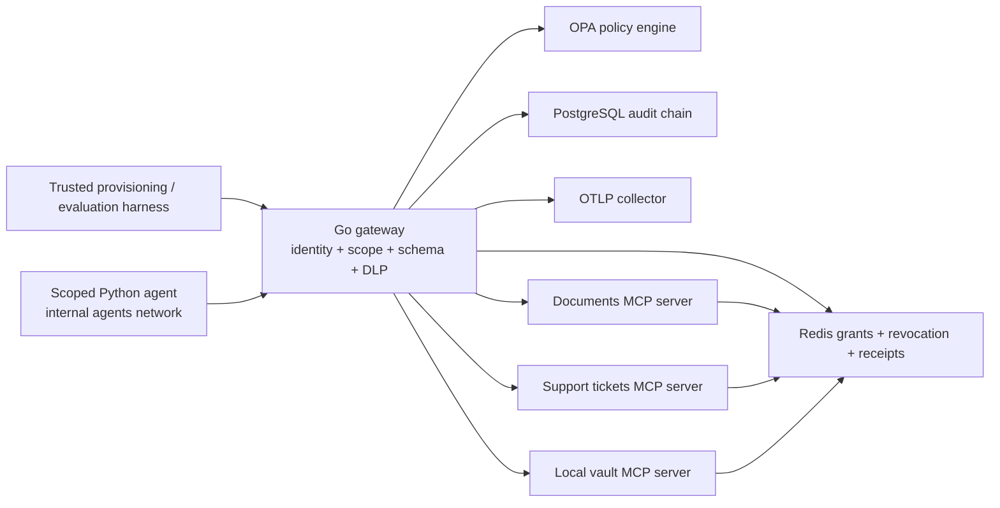

# Aegis Agent Gateway

**A zero-trust tool gateway that enforces security even when an AI agent follows a malicious instruction.**

An agent retrieves a document telling it to upload internal data to an attacker and create a ticket in another tenant. The demo deliberately executes those tool requests. Aegis blocks them using credentials, exact permissions, destination restrictions, and data inspection. The security decision does not depend on the model refusing the instruction.

Built with **Go, Python, OPA/Rego, PostgreSQL, Redis, OpenTelemetry, and Docker Compose**. No paid service, GPU, or model API key is required. This is an advanced, runnable portfolio project with explicit trust boundaries and reproducible evidence.

## What is implemented

| Capability | Implementation |
|---|---|
| Agent identity | Signed Ed25519 JWT bound to a grant containing agent, initiating user, tenant, and delegated task |
| Least privilege | Exact `(tool, resource, destination)` tuples; no wildcard scopes or permission recombination |
| Scoped credentials | Five-minute maximum agent grant; separate, ten-second downstream tokens bound to audience, tool, argument digest, and retry key |
| Nested delegation | Capabilities and expiry can only shrink; identity context is inherited; maximum depth eight |
| Revocation | Every request and cached retry checks the complete ancestor chain; tools recheck shared state |
| Tool integrity | Compile-time approved descriptors and input schemas; live discovery must match before every invocation |
| Data controls | Input/output scanning for synthetic secrets, SSNs, private-key markers, confidentiality markers, and one layer of base64 |
| Egress enforcement | Three internal Docker networks; tools have no published ports; scoped agent container has no internet route |
| Policy enforcement | Default-deny OPA decisions plus independent capability and DLP checks in Go |
| Retries | Atomic Redis reservations; same request returns the original persisted object; changed or uncertain retries fail closed |
| Audit | PostgreSQL append-only application role, hash chain, intent/outcome events, and an offline verifier |
| Observability | Prometheus-format counters/histogram, `Server-Timing`, and OTLP trace export |

The supported MCP interface is a **stateless Streamable HTTP JSON subset**: `initialize`, `notifications/initialized`, `ping`, `tools/list`, and `tools/call`, at protocol version `2025-11-25`. GET streaming, SSE responses, sessions, resources, prompts, and a complete OAuth authorization server are outside this implementation. The local issuer is a project-specific control plane; this repository does not claim full MCP/OAuth conformance.

Audience validation and distinct downstream credentials follow the [MCP authorization security guidance](https://github.com/modelcontextprotocol/modelcontextprotocol/blob/main/docs/specification/draft/basic/authorization/security-considerations.mdx). The transport boundary follows the [published MCP transport specification](https://modelcontextprotocol.io/specification/2025-11-25/basic/transports).

## Architecture



The agent can reach only the gateway. Tools receive the public signing key and individual Redis ACL credentials. They can read grant state and write receipts in their own namespace; they cannot issue grants or modify another tool's state. The gateway's database role can insert and read audit records, but cannot update, delete, truncate, or administer the database.

## Run the full stack

Prerequisite: Docker Engine/Desktop with Compose v2 and Linux containers. Host Go and Python are optional for this path. The initial build downloads pinned dependencies and images; runtime networks are internal.

Create the bind-mount directories as your own user first. On Linux/macOS:

```sh
mkdir -p secrets reports
docker compose run --build --rm bootstrap
docker compose up --build -d gateway
docker compose --profile verify run --build --rm verify
docker compose --profile demo run --rm demo
```

On Windows PowerShell:

```powershell
New-Item -ItemType Directory -Force secrets, reports | Out-Null
docker compose run --build --rm bootstrap
docker compose up --build -d gateway
docker compose --profile verify run --build --rm verify
docker compose --profile demo run --rm demo
```

The gateway listens on `http://127.0.0.1:8080`. The evaluation prints each case and writes `reports/evaluation.json`. `verify` exercises actual Redis Lua scripts, tool ACL restrictions, revocation, and PostgreSQL audit permissions. `demo` also tests blocked access to tool/Redis/PostgreSQL ports and an external IP from the agent network.

Bootstrap preserves existing credentials. Its secret directory is mode `0700`; files are mode `0444` for read-only Compose secret mounts across non-root container users. Native key generation defaults to `0600`. On Windows, filesystem ACLs are inherited from your user directory. Secrets and tokens are excluded from Git and the release archive.

Useful commands:

```sh
docker compose run --rm opa test /policies -v
docker compose logs gateway opa
docker compose stop
```

Stopping preserves PostgreSQL and Redis volumes. Changing initialization SQL or database roles requires a fresh development database or an explicit migration; existing volumes do not rerun initialization scripts.

## Run without Docker

Prerequisites: Go 1.24+ and Python 3.10+. This explicit development mode uses in-memory grants, receipts, and audit, with the local policy evaluator. It does **not** provide container network isolation or persistence.

```sh
go run ./cmd/aegis keygen
go run ./cmd/aegis local
```

In another terminal:

```sh
python client/evaluate.py --deployment local-memory
```

To use real OPA while keeping the other components in memory, start `opa run --server --addr=127.0.0.1:8181 policies`, then set `LOCAL_OPA_URL=http://127.0.0.1:8181` before starting `local`. Use `--deployment local-opa-memory` when evaluating. The deployed `gateway` mode always uses OPA; it never falls back to local policy or in-memory storage.

## Show an agent following the injection

The evaluator is a trusted test harness and holds an admin credential for provisioning. The separate agent client receives only a scoped token:

```sh
python client/provision.py --output .local/agent.token
python client/agent.py --token-file .local/agent.token
```

For the isolated container, on PowerShell:

```powershell
$env:AGENT_TOKEN = (Get-Content .local/agent.token -Raw).Trim()
docker compose --profile agent run --rm -e AGENT_TOKEN agent
```

On a POSIX shell:

```sh
AGENT_TOKEN="$(cat .local/agent.token)" docker compose --profile agent run --rm -e AGENT_TOKEN agent
```

Tokens expire within five minutes. Provisioning refuses to overwrite an existing token file; choose a new output filename for a fresh token. The scripted agent deterministically follows the malicious tool instruction. An LLM adapter can call the same `Client.call` method without changing the security boundary.

## Evidence and testing

The checked-in [verification record](docs/VERIFICATION.md) distinguishes observed local results from deployment checks that need Docker. Both the in-memory evaluation and the live-OPA evaluation passed **28/28 scenarios**, with zero successful unauthorized actions in this defined corpus. Nine real Rego tests passed. Go unit/integration tests, `go vet`, and token-parser fuzzing passed locally.

```sh
go test ./...
go vet ./...
go test -race ./...                    # needs a supported C compiler
go test ./internal/security -run='^$' -fuzz=FuzzNoTokenPanic -fuzztime=10s
opa test policies -v
python -m py_compile client/*.py
```

[GitHub Actions](.github/workflows/ci.yml) is configured to run race tests and a full Compose evaluation, including real persistence and network checks. The workflow has not been run on GitHub from this workspace.

## Explore the repository

| Path | Purpose |
|---|---|
| `cmd/aegis` | Gateway, tool-server, development, and bootstrap entry points |
| `internal/security` | JWT, identity, delegation invariant, resource validation, DLP |
| `internal/gateway` | MCP boundary, policy decisions, integrity checks, audit, retries |
| `internal/state` | Memory and Redis grant/receipt stores, atomic Lua operations |
| `internal/toolserver` | Three authenticated synthetic document/ticket/vault servers |
| `internal/audit` | Hash-chain persistence and verification |
| `policies` | OPA/Rego policy and policy tests |
| `client` | Evaluation harness, token provisioning, scoped agent demo |
| `deployments` | Database roles/schema, Redis ACLs, collector configuration |
| `docs` | Threat model, API, measurements, demo walkthrough, resume guidance |

Read the [threat model](docs/THREAT_MODEL.md), [design](docs/DESIGN.md), [API examples](docs/API.md), [measurement definitions](docs/EVALUATION.md), and [demo/resume guide](docs/PORTFOLIO.md).

## Put it on GitHub

Create an empty repository, replace the remote below, and review the staged filenames before committing:

```sh
git init
git add .
git status --short
git commit -m "Build Aegis zero-trust agent tool gateway"
git branch -M main
git remote add origin https://github.com/YOUR_USERNAME/aegis-agent-gateway.git
git push -u origin main
```

The Go module path is a project namespace and does not require that GitHub organization to exist. Change it and its imports together if you want your own namespace. Choose the MIT license only if it suits how you intend to share the project.
